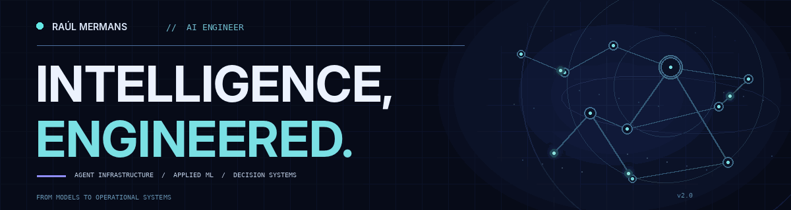
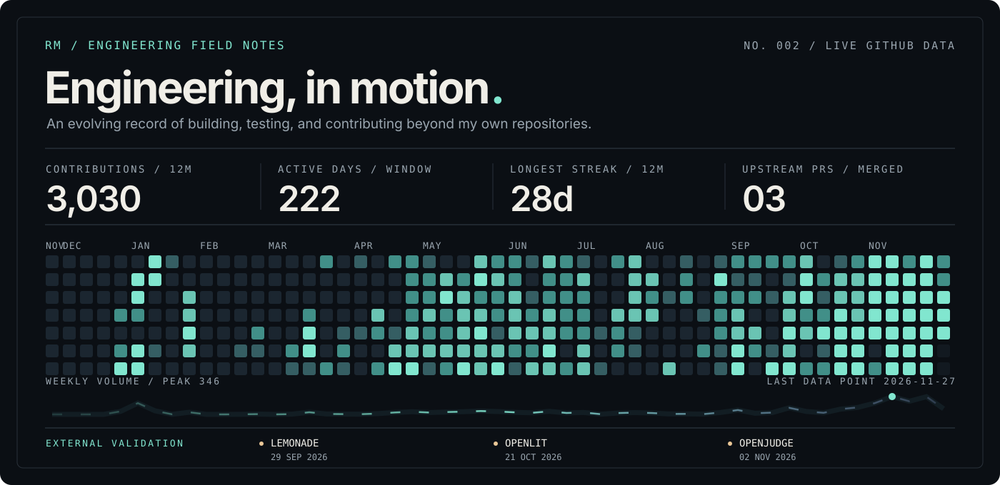

  

  

  

    
    
    
  

### About

I'm an **Applied AI Engineer** building reliable AI agents, developer tools, and full-stack software for real operational problems.

My work combines **Python and TypeScript engineering with product thinking and commercial experience**. I build internal software and decision-support workflows, and independently develop agent infrastructure focused on execution, evaluation, and failure recovery.

I care about the entire engineering process: understanding the problem, implementing the system, testing its behavior, and being clear about what the evidence does—and doesn't—prove.

**Build the system. Test the behavior. Show the evidence.**

---

### Selected work

<table>
<tr>
<td width="50%" valign="top">
<strong><a href="https://github.com/RaulMermans/Reeprov">Reeprov ↗</a></strong> 
<strong>Reproduce the failure. Prove the fix.</strong>  
Local-first agent debugging infrastructure for execution capture, offline replay, causal comparison, and CI regression checks. Built with TypeScript and Python client SDKs.  
Agent reliability · TypeScript + Python · Public beta
</td>
<td width="50%" valign="top">
<strong><a href="https://github.com/RaulMermans/Open_VS_Code">Open VS Code Agent ↗</a></strong> 
<strong>Measure the agent, not just the demo.</strong>  
Local coding agent with open-weight models, bounded tools, and reproducible evaluation. Improved from 9/24 to 18/24 successful tasks on a documented read-only benchmark; desktop validation continues.  
TypeScript · Qwen · Local inference · Active development
</td>
</tr>
<tr>
<td width="50%" valign="top">
<strong><a href="https://github.com/RaulMermans/OpsTwin">OpsTwin ↗</a></strong> 
<strong>Test operational changes before rollout.</strong>  
Deployed decision-support software comparing staffing and service-workflow scenarios through paired simulations, explicit constraints, and uncertainty-aware results.  
Next.js · FastAPI · SimPy · <a href="https://ops-twin.vercel.app">Live demo</a>
</td>
<td width="50%" valign="top">
<strong><a href="https://github.com/RaulMermans/Eyes-Without-A-Face">Eyes Without a Face ↗</a></strong> 
<strong>Integrate without exposing private data.</strong>  
Privacy-aware integration builder using on-device analysis and fictional data stand-ins for cloud-assisted field mappings. Real records stay local during validation and export.  
Hybrid AI · Gemini · Firebase · Assisted mapper · <a href="https://eyes-without-a-face-b7281.web.app">Demo</a>
</td>
</tr>
<tr>
<td width="50%" valign="top">
<strong><a href="https://github.com/RaulMermans/moody-blues">Moody Blues ↗</a></strong> 
<strong>Verify what an AI agent actually did.</strong>  
Fault-injection testbed for AI agents, comparing reported outcomes against independently inspected state. Reproduced 28/28 documented failures on scripted targets.  
Python · Docker · Agent testing · Developer alpha
</td>
<td width="50%" valign="top">
<strong><a href="https://github.com/RaulMermans/AETHRA">AETHRA · NASA Space Apps ↗</a></strong> 
<strong>Earth data. Testable insights. Clear limits.</strong>  
Team-built NASA Space Apps 2026 project turning Earth data into testable climate trends. Contributed Python analysis, evidence cards, interactive mapping, and release validation.  
NASA Space Apps 2026 · Python · CesiumJS · <a href="https://nasa-project-spain.vercel.app/explore">Live app</a>
</td>
</tr>
</table>>

---

### Engineering in progress

- **[IRIS OS](https://github.com/RaulMermans/IRIS-OS)** — Experimental personal AI environment for specialist-agent orchestration, context, memory, and controlled execution. Public repository documents the architecture.
- **[HALO Control](https://github.com/RaulMermans/AMD-HALO-Control)** — Local-first AI compute control plane. Operator-supervised inference admission and governed 4B/14B-class runtime lifecycle physically exercised on AMD Halo (November 2026). [Public acceptance evidence](https://github.com/RaulMermans/AMD-HALO-Control/blob/main/docs/PHYSICAL_ACCEPTANCE_2026-11-22.md); private implementation, single-host pilot—not production certification.
- **[AAO / Applied AI Operations](https://github.com/RaulMermans/applied-ai-operations)** — Reusable infrastructure for AI workflow controls, approvals, integrations, and execution governance.

### Beyond AI infrastructure

**[Cultural Elasticity](https://github.com/RaulMermans/cultural-elasticity)** · **[BI Notebook Lab](https://github.com/RaulMermans/bi-notebook-lab)** ([Demo](https://raulmermans.github.io/bi-notebook-lab/)) · **[DemandOS](https://github.com/RaulMermans/demand-OS)** · **[Relay](https://github.com/RaulMermans/Relay)** · **[DataBrief AI](https://github.com/RaulMermans/DataBrief-AI)** · **[SearchSignal](https://github.com/RaulMermans/SearchSignal)** · **[Website Audit Agent](https://github.com/RaulMermans/website-auditor)**

Additional work across analytics, simulation, automation, learning tools, and commercial decision-making. BI Notebook Lab includes an executable DAX learning engine with documented test coverage and conformance cases.

---

### Open-source contributions

| Project | Contribution | Result |
|---|---|---|
| [Lemonade](https://github.com/lemonade-sdk/lemonade/pull/3684) | Reject invalid backend-specific configuration keys | **Merged** |
| [OpenLIT](https://github.com/openlit/openlit/pull/1667) | LangGraph memory connector | **Merged** |
| [OpenJudge](https://github.com/agentscope-ai/OpenJudge/pull/200) | Fix degenerate empty-string grader matches | **Merged** |

---

### Technical stack

  

AI agents · Agent evaluation & observability · MCP · Local inference / Ollama · Tool execution · Pytest · Playwright · Vitest · SimPy · DAX

---

### Engineering, in motion

  

Regenerated daily from GitHub contribution data. External pull-request milestones are verified historical merges.

**Upstream contributions:** [Lemonade ↗](https://github.com/lemonade-sdk/lemonade/pull/3684) · [OpenLIT ↗](https://github.com/openlit/openlit/pull/1667) · [OpenJudge ↗](https://github.com/agentscope-ai/OpenJudge/pull/200)

---

FROM MODELS TO OPERATIONAL SYSTEMS.

