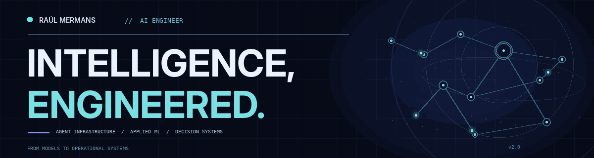
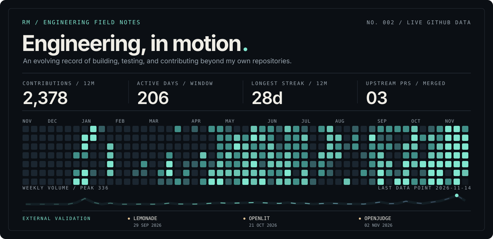

  

  

  

    
    
    
  

### About

I'm an **Applied AI Engineer** building intelligent systems, developer tools, and software products that solve real problems.

My background combines **engineering, product thinking, and business operations**. I'm interested in what happens when AI moves beyond a prototype: how systems integrate with existing infrastructure, how agents behave under failure, and how we verify that something actually works.

I work from understanding a problem and designing its architecture to implementation, integration, testing, and evaluation.

**Building something is only half the challenge. Proving it works is the other half.**

---

### Selected work

<table>
<tr>
<td width="50%" valign="top">
<strong><a href="https://github.com/RaulMermans/Eyes-Without-A-Face">Eyes Without a Face ↗</a></strong> 
<strong>Build for systems your AI cannot see.</strong>  
A privacy-aware hybrid AI system that lets cloud models propose integrations without accessing underlying private records. Combines on-device inference, controlled disclosure, cloud reasoning, and local verification.  
Hybrid AI · Gemini · Firebase · Privacy Engineering · Release candidate
</td>
<td width="50%" valign="top">
<strong><a href="https://github.com/RaulMermans/Reeprov">Reeprov ↗</a></strong> 
<strong>Reproduce the failure. Prove the fix.</strong>  
Local-first debugging infrastructure for AI agents: execution capture, replay, causal comparison, evaluations, and reproducible regression checks.  
Agent Reliability · TypeScript + Python SDKs · Public beta
</td>
</tr>
<tr>
<td width="50%" valign="top">
<strong><a href="https://github.com/RaulMermans/moody-blues">Moody Blues ↗</a></strong> 
<strong>Test what agents do. Verify what actually happened.</strong>  
A controlled fault-injection environment that tests agent behavior against committed state using an independent Truth Oracle.  
Python · Docker · Fault injection · 28/28 documented synthetic failures reproduced · Developer alpha
</td>
<td width="50%" valign="top">
<strong><a href="https://github.com/RaulMermans/OpsTwin">OpsTwin ↗</a></strong> 
<strong>Test operational decisions before making them.</strong>  
Decision-support software comparing staffing and workflow changes through paired simulation and uncertainty-aware analysis.  
Next.js · FastAPI · SimPy · <a href="https://ops-twin.vercel.app">Demo</a>
</td>
</tr>
<tr>
<td width="50%" valign="top">
<strong><a href="https://github.com/RaulMermans/cultural-elasticity">Cultural Elasticity ↗</a></strong> 
<strong>Research cultural relevance with evidence.</strong>  
Agentic cultural intelligence combining Claude, Qloo data, bounded investigations, and evidence-backed strategic analysis.  
AI Agents · Qloo · Commercial intelligence · Research prototype
</td>
<td width="50%" valign="top">
<strong><a href="https://github.com/RaulMermans/bi-notebook-lab">BI Notebook Lab ↗</a></strong> 
<strong>Understand how DAX evaluates.</strong>  
An in-browser analytical learning environment with an expression engine, filter propagation, semantic models, and executable grading.  
TypeScript · 1,024 reported passing tests · 82/83 hand-verified cases · <a href="https://raulmermans.github.io/bi-notebook-lab/">Demo</a>
</td>
</tr>
</table>

---

### Engineering in progress

- **[Open VS Code Agent](https://github.com/RaulMermans/Open_VS_Code)** — Local-first coding-agent desktop environment built around open-weight models, governed tool execution, and reproducible evaluation. A documented 24-task read-only benchmark improved from 37.5% to 75%; real-world desktop acceptance remains in progress.
- **[IRIS OS](https://github.com/RaulMermans/IRIS-OS)** — Personal AI operating system exploring specialist-agent orchestration, memory, context, and governed execution. Public repository is an architecture edition.
- **[HALO Control](https://github.com/RaulMermans/AMD-HALO-Control)** — Local AI infrastructure for routing, model management, workload governance, and resource observability. Public architecture edition; runtime acceptance is incomplete.
- **AAO / Applied AI Operations** — Private reusable foundation for governed AI workflows, approvals, execution controls, and integrations.

### Beyond AI infrastructure

**[DemandOS](https://github.com/RaulMermans/demand-OS)** · **[Relay](https://github.com/RaulMermans/Relay)** · **[DataBrief AI](https://github.com/RaulMermans/DataBrief-AI)** · **[SearchSignal](https://github.com/RaulMermans/SearchSignal)** · **[Website Audit Agent](https://github.com/RaulMermans/website-auditor)**

These projects explore forecasting, analytics, automation, and AI-assisted decision-making in commercial and operational settings.

---

### Open-source contributions

| Project | Contribution | Result |
|---|---|---|
| [Lemonade](https://github.com/lemonade-sdk/lemonade/pull/3684) | Reject invalid backend-specific configuration keys | **Merged** |
| [OpenLIT](https://github.com/openlit/openlit/pull/1667) | LangGraph memory connector | **Merged** |
| [OpenJudge](https://github.com/agentscope-ai/OpenJudge/pull/200) | Fix degenerate empty-string grader matches | **Merged** |

---

### Technical stack

  

AI Agents · Agent Orchestration · MCP · Local inference / Ollama · Evaluation & Observability · Playwright · Pytest · Vitest · SimPy · Applied ML · DAX

---

### Engineering, in motion

  

Regenerated daily from GitHub contribution data. External pull-request milestones are verified historical merges.

**Upstream contributions:** [Lemonade ↗](https://github.com/lemonade-sdk/lemonade/pull/3684) · [OpenLIT ↗](https://github.com/openlit/openlit/pull/1667) · [OpenJudge ↗](https://github.com/agentscope-ai/OpenJudge/pull/200)

---

FROM MODELS TO OPERATIONAL SYSTEMS.

