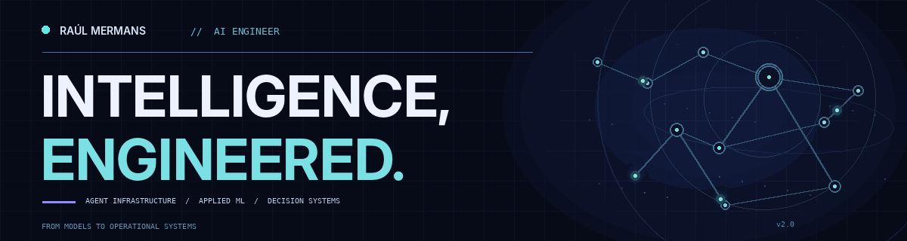

  

  

  

    
    
    
  

### About

I'm an **AI Engineer** building the infrastructure and products that turn intelligent models into usable systems. My work spans **agent reliability, orchestration, local inference, applied machine learning, simulation, and decision intelligence**.

I care about what happens beyond the demo: architecture, evaluation, operational boundaries, and whether the product solves a real problem.

### Featured work

<table>
<tr>
<td width="50%" valign="top">
<strong><a href="https://github.com/RaulMermans/Reeprov">Reeprov ↗</a></strong> 
Local-first debugging infrastructure for AI agents: capture, replay, causal comparison, evaluations, and regression gates.  
Agent reliability · TypeScript + Python SDKs · Public beta
</td>
<td width="50%" valign="top">
<strong><a href="https://github.com/RaulMermans/OpsTwin">OpsTwin ↗</a></strong> 
Decision lab comparing operational changes through paired, repeated simulation and uncertainty-aware evidence.  
Next.js · FastAPI · SimPy · 430 reported passing tests · <a href="https://ops-twin.vercel.app">Live demo</a>
</td>
</tr>
<tr>
<td width="50%" valign="top">
<strong><a href="https://github.com/RaulMermans/bi-notebook-lab">BI Notebook Lab ↗</a></strong> 
Browser-based DAX learning lab with an expression engine, semantic models, filter propagation, and executable grading.  
TypeScript · 1,024 reported passing tests · 82/83 hand-verified DAX cases · <a href="https://raulmermans.github.io/bi-notebook-lab/">Live demo</a>
</td>
<td width="50%" valign="top">
<strong><a href="https://github.com/RaulMermans/Relay">Relay ↗</a></strong> 
A source-aware marketing analytics workspace for Meta Ads, Google Ads, and Shopify CSV exports.  
Next.js · Data quality · 304 reported passing tests · Protected beta
</td>
</tr>
<tr>
<td width="50%" valign="top">
<strong><a href="https://github.com/RaulMermans/Open-VS-Code-Agent">Open VS Code Agent ↗</a></strong> 
A coding-agent system optimized for a local 7B open-weight model, with strict tool boundaries and reproducible evaluation.  
Ollama · Local inference · 37.5% → 75% success on a 24-task read-only benchmark · Public architecture edition
</td>
<td width="50%" valign="top">
<strong><a href="https://github.com/RaulMermans/demand-OS">DemandOS ↗</a></strong> 
Demand forecasting and inventory-risk planning with leakage-aware feature engineering, backtesting, and human-reviewed reorder proposals.  
Python · Applied ML · Synthetic-data portfolio MVP · <a href="https://demand-os-three.vercel.app">Live demo</a>
</td>
</tr>
</table>

### Currently engineering

- **AAO / Applied AI Operations** — a private, reusable foundation for governed AI workflows, execution, approvals, and adapter portability.
- **[IRIS OS](https://github.com/RaulMermans/IRIS-OS)** — an attention-first personal AI operating system with bounded specialist agents. The public repository documents the architecture; external side effects are not production-enabled.
- **[HALO Control](https://github.com/RaulMermans/AMD-HALO-Control)** — a local AI control plane for workload orchestration and model routing. The public repository is an architecture edition, and AMD Halo hardware verification remains pending.

Other experiments: **[DataBrief AI](https://github.com/RaulMermans/DataBrief-AI)** · **[SearchSignal](https://github.com/RaulMermans/SearchSignal)** · **[Website Audit Agent](https://github.com/RaulMermans/website-auditor)** · **[Overflow iOS](https://github.com/RaulMermans/overflow-training)**

### Technical stack

  

Agent orchestration · MCP · Local inference / Ollama · Evaluation harnesses · Playwright · Pytest · Vitest · SimPy · DAX

### Open-source contributions

- **[Lemonade — backend configuration validation](https://github.com/lemonade-sdk/lemonade/pull/3684)** — merged contribution rejecting invalid backend-specific configuration keys.
- **[OpenLIT — LangGraph memory connector](https://github.com/openlit/openlit/pull/1667)** — contribution proposing a memory connector with CRUD/search, authentication, and integration tests.
- **[OpenJudge — empty-string grader edge case](https://github.com/agentscope-ai/OpenJudge/pull/200)** — contribution addressing degenerate empty-string matches.

### GitHub signals

  

### Activity Signal

Updated automatically from my GitHub contribution history.

---

FROM MODELS TO OPERATIONAL SYSTEMS.

